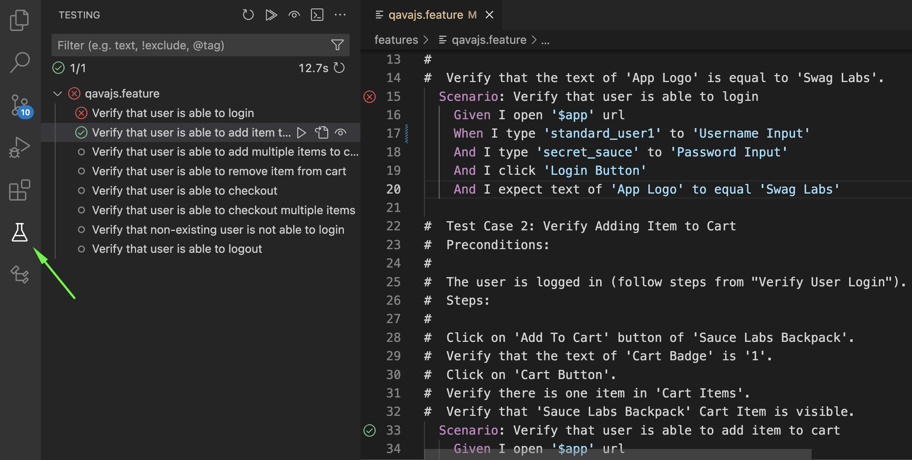

# qavajs VSCode extension

VS Code support for the [qavajs](https://qavajs.github.io/) test automation framework, built on the official Cucumber language server.

## Features

### Gherkin editing
- Syntax highlighting for `.feature` files
- Step autocomplete based on step definitions found via `cucumber.glue` (including the built-in `@qavajs/*` steps)
- Go to step definition
- Document formatting and Gherkin syntax diagnostics
- Outline and breadcrumbs; folding of scenarios, rules, backgrounds, Examples, data tables, doc strings and comment blocks
- Workspace-wide scenario search (<kbd>Ctrl</kbd>/<kbd>Cmd</kbd>+<kbd>T</kbd>)

> Undefined-step diagnostics are intentionally disabled: qavajs resolves many steps at runtime
> (memory values, page objects), so they would produce false positives.

### Step documentation
- Hovering a step shows its step definition's JSDoc (description, params, `@example`) and a link to the definition

### Test Explorer


- Feature files, Rules, Scenarios, Scenario Outlines and individual Examples rows are shown as a tree
- Run anything from a whole folder down to a single example row. Tests are selected by location (`file.feature:line`), so duplicate scenario names and special characters in names are handled correctly
- All selected tests of a workspace folder run in **one qavajs process**, so browsers and the qavajs bootstrap start once per run
- **Debugging**: every launch profile also has a debug profile; breakpoints in step definitions and support code work (uses the built-in JavaScript debugger)
- Live per-scenario status and durations; the error is shown inline **on the failing step** (or on the failing hook)
- **Expected/actual diff** for equality assertions, and clickable stack frames
- Step-by-step output, `console.log` and qavajs logs are linked to their scenario in the Test Results panel
- Screenshots and other attachments are saved and linked from the failure message
- Retries are shown in the output; scenarios that pass after a retry are flagged as flaky
- Gherkin `@tags` become Test Explorer tags: filter with `@qavajs:smoke`
- Outline, Rule and Feature status is derived from their children
- Continuous run (watch mode) for every launch profile
- Cancelling a run stops the whole process tree, including browsers started by the tests
- Multi-root workspaces: settings are read per workspace folder
- Running tests requires a [trusted workspace](https://code.visualstudio.com/docs/editor/workspace-trust); launch settings from the workspace are ignored until it is trusted

## Extension Settings

* `cucumber.features`: gherkin file globs (array, default `["features/**/*.feature"]`)
* `cucumber.glue`: step definition file globs (array)
* `cucumber.parameterTypes`: custom parameter types defined outside of `cucumber.glue` (array)
* `qavajs.launchProfiles`: named launch profiles shown in the Test Explorer run and debug dropdowns (array of `{ name, command, env?, cwd?, tags? }`)
* `qavajs.launchCommand` *(deprecated)*: command used when `qavajs.launchProfiles` is empty (default `npx qavajs run`)

```json
{
    "cucumber.features": [
        "features/**/*.feature"
    ],
    "cucumber.glue": [
        "node_modules/@qavajs/**/src/*.ts",
        "step_definition/*.ts"
    ],
    "qavajs.launchProfiles": [
        { "name": "Dev", "command": "npx qavajs run --config dev.config.ts", "env": { "HEADLESS": "false" } },
        { "name": "Smoke", "command": "npx qavajs run --config ci.config.ts", "tags": "@smoke and not @wip" }
    ]
}
```

Each launch profile appears as a separate entry in the Test Explorer run and debug dropdowns, and the first one is the default.
`env` adds environment variables, `cwd` sets the working directory (relative to the workspace folder) and `tags` adds `--tags`.
`${workspaceFolder}` and `${env:NAME}` are substituted in `command`, `cwd` and `env`.

The extension appends `--paths <file[:line]>... [--tags <expr>] --format message` to the command (debug runs use `--format message:<file>`),
so the command must accept these qavajs CLI options.
Tests run from the workspace folder that contains the feature file. In a multi-root workspace, a folder can define its own
profile with the same name to override the workspace one.

## Known Issues and Limitations

* Requires VS Code 1.145 or newer
* Requires @qavajs/core > 2
* qavajs merges `paths` from the config with `--paths`: if your config sets `paths`, running a single scenario also runs the
  other feature files matched by the config (their results are ignored). Use a profile with a config without `paths` for fast single-test runs
* Step hover docs come from scanning `cucumber.glue` sources; steps registered dynamically (not as literal strings or regexes) are not documented

## Development

```sh
npm ci
npm run typecheck && npm run lint && npm test   # tsc + Biome + Vitest
npm run test:watch                              # Vitest in watch mode
npm ci --prefix test-fixtures/project           # once: qavajs fixture project for integration tests
npm run test:integration                        # build + run tests inside VS Code (downloads VS Code stable)
npm run vsce                                    # build qavajs-<version>.vsix
```

Integration tests (`src/integration`) run in a real VS Code against the qavajs project in `test-fixtures/project`,
covering discovery, runs, debugging, cancellation, launch profiles and language features. On Linux without a display,
run them with `xvfb-run -a npm run test:integration`.

Press <kbd>F5</kbd> in VS Code to launch an Extension Development Host.
